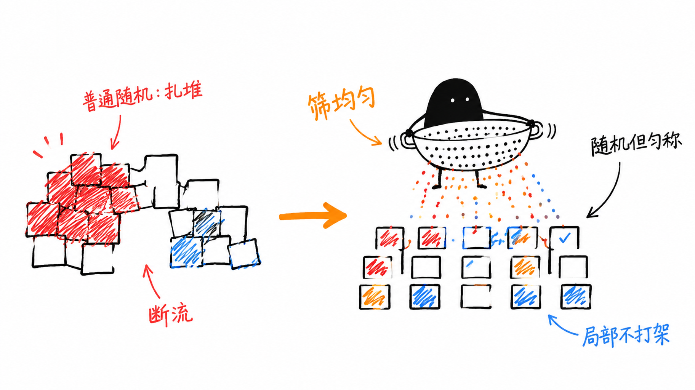

# ai-map-color-distributor（随机分配颜色）

用于 Adobe Illustrator 的矢量图元空间均匀赋色脚本。在保证三色比例（默认 50% / 30% / 20%）的前提下，通过空间网格划分、蛇形扫描与微块误差扩散，避免纯随机带来的颜色扎堆或局部断流，适合建筑群、集装箱堆场、网格区块等万级图元场景。

## 直接下载脚本

- **下载主脚本**：[随机分配颜色.jsx](https://raw.githubusercontent.com/Goose53-lee/ai-map-color-distributor/main/%E9%9A%8F%E6%9C%BA%E5%88%86%E9%85%8D%E9%A2%9C%E8%89%B2.jsx)（若浏览器直接打开文本，按 `Cmd+S` / `Ctrl+S` 保存为 `.jsx` 文件）
- **仓库打包下载**：[Download ZIP](https://github.com/Goose53-lee/ai-map-color-distributor/archive/refs/heads/main.zip)

## 安装到 Illustrator

将下载的 `随机分配颜色.jsx` 放入对应系统的脚本目录，重启 Illustrator 后在 **文件 > 脚本 > 随机分配颜色** 调用：

- **macOS**：`/Applications/Adobe Illustrator <年份>/Presets.localized/zh_CN/脚本/`（英文版为 `en_US/Scripts/`）
- **Windows**：`C:\Program Files\Adobe\Adobe Illustrator <年份>\Presets\zh_CN\脚本\`

## 使用步骤

1. 在 Illustrator 中选中需要赋色的图形或编组。
2. 点击 **文件 > 脚本 > 随机分配颜色**。
3. 选择 **浅色模式** 或 **深色模式**，按需修改 HEX 色值、分配比例与不透明度。
4. 点击 **开始分配颜色**，等待进度条自动关闭。

## 默认色板与特性

- **浅色预设**：`#dde5ed` / `#d0dfea` / `#c3d2e2`（100% 不透明度）
- **深色预设**：`#445668` / `#3b516b` / `#34455e`（75% 不透明度）
- **自动适配**：穿透任意深度编组，自动匹配文档 RGB / CMYK 色彩空间；比例按三项总和自动归一化。
- **修改默认预设**：编辑 `随机分配颜色.jsx` 顶部的 `THEME_CONFIG` 对象后保存即可。

> 若选区包含锁定对象或未释放的剪切蒙版，请先解锁或释放后再运行。
